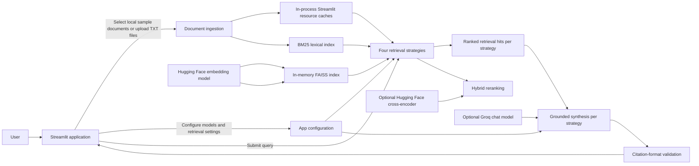
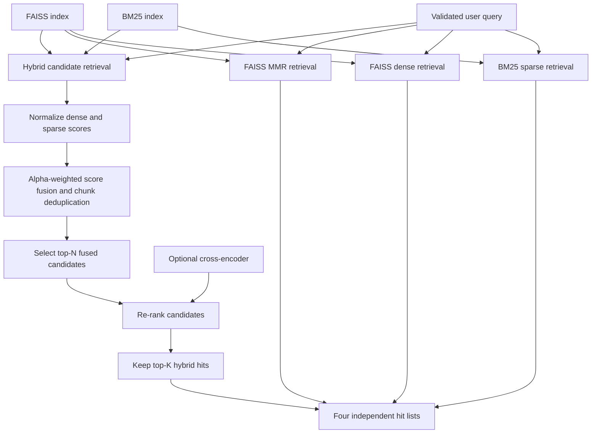

# RAG Demo: System Architecture and Workflow

This document describes the workflow implemented by this repository. It is
written both as a human-readable architecture summary and as input for generating
a system diagram.

## 1. Scope

The application is a single-process Streamlit demo that compares lexical,
dense-vector, diversity-aware, and hybrid retrieval over selected `.txt` files.
It displays retrieved chunks and asks a language model to synthesize a cited
answer for each retrieval strategy.

The sample document discusses agents, LangChain, and MCP as generative-AI
concepts. Those are document content, not components implemented by this
application. The code does not implement an autonomous agent, an MCP server, a
remote vector database, or a persistent chat-memory layer.

## 2. System Context

## 3. End-to-End Workflow

### A. Startup and configuration

1. `app.py` starts the Streamlit UI and calls `load_config()`.
2. `src/config.py` loads environment values from the project `.env` file and
   supplies defaults for chunking, top-K, MMR, reranking, and hybrid alpha.
3. The sidebar lets the user choose model names, an optional Groq API key, and
   retrieval parameters. Sidebar values are combined with the loaded settings
   into the active per-query configuration.
4. The user selects either recursively discovered sample `.txt` files or
   uploaded `.txt` files, enters a question, and submits the form.

### B. Document loading and index preparation

1. `app.py` creates a source bundle containing the source kind, source items,
   and a SHA-256 digest of file names and contents.
2. `_cached_corpus` loads local files with `TextLoader` or reads uploaded file
   content through temporary files. Uploaded temporary files are removed after
   loading.
3. `src/ingestion.py` attaches source-file and document-title metadata, then
   `RecursiveCharacterTextSplitter` splits documents using the configured chunk
   size and overlap.
4. Each chunk receives a chunk ID, zero-based chunk index, source filename, and
   document title.
5. The chunks build a BM25 lexical retriever.
6. If an embedding model is configured, a cached Hugging Face embedding model
   creates an in-memory FAISS vector store from those chunks. The vector store
   is cached using the corpus digest, embedding model name, and chunk settings.
7. The corpus, embeddings, vector store, and optional cross-encoder use
   `st.cache_resource`; these are runtime caches, not a durable index store.

### C. Query validation and retrieval

After checking that the query and source bundle are present, the app runs the
retrieval strategies. Each strategy produces its own ordered list of
`RetrievalHit` objects, carrying chunk text, rank, score information, metadata,
and a source citation reference.

Retrieval strategy details:

- **Sparse (BM25):** ranks chunks using lexical token matching. Its raw scores are
  query/corpus-relative and are not directly comparable with FAISS scores.
- **Dense (FAISS):** returns nearest chunks and the vector store's raw score.
  The score is metric-dependent, not a calibrated relevance probability.
- **MMR:** selects chunks by balancing query relevance with diversity. It
  reports selection order rather than a per-hit score.
- **Hybrid + reranking:** retrieves dense and BM25 candidate lists, normalizes
  each list, combines scores using alpha, deduplicates chunks, selects top-N,
  then uses a cross-encoder to re-rank and return top-K. Alpha 1 favors dense
  scores; alpha 0 favors sparse scores.

Sparse retrieval is run directly. Dense, MMR, and hybrid retrieval require the
FAISS index; hybrid also requires a configured cross-encoder. Missing or
unavailable models are shown as per-panel UI errors rather than silently
substituted with another retrieval strategy.

### D. Retrieval display and grounded synthesis

1. The UI displays each strategy's retrieved chunks, ranks, score labels,
   metadata, and `[SRC-n]` references.
2. The app calls `generate_grounded_answer()` separately for each strategy,
   using that strategy's hits and the same user query. Therefore the four
   synthesis panels can differ because their retrieved evidence differs.
3. If both Groq settings are available, the app formats the hits as numbered
   `[SRC-n]` evidence blocks and invokes the configured Groq chat model at
   temperature 0. The system prompt requires an answer grounded only in those
   blocks, citations for factual sentences, and explicit coverage gaps for
   partially supported comparisons.
4. If Groq settings are incomplete, the local fallback takes the first sentence
   from each retrieved hit and adds its citation. This fallback does not
   synthesize a comparison or infer missing information.
5. With no hits, generation returns the exact insufficient-context response.
6. `validate_citations()` retains sentences only when each has trailing
   citations that refer to source IDs in that panel's retrieved hits. If no
   sentence survives, it returns the insufficient-context response.
7. The UI displays the answer, source-to-chunk mapping, and a citation-format
   status. This validation checks citation placement and source-ID validity; it
   does not verify that a cited passage entails or supports a claim.

## 4. Component Map

| Component | Responsibility |
|---|---|
| `app.py` | Streamlit UI, source selection, cache orchestration, retrieval calls, panel rendering, synthesis calls, and timing display |
| `src/config.py` | Environment loading, configuration defaults, and required-setting validation |
| `src/ingestion.py` | Local/uploaded text loading, metadata, chunk splitting, embeddings, FAISS construction, and BM25 construction |
| `src/retrievers.py` | Retrieval-hit type and dense, sparse, MMR, and hybrid/reranked retrieval algorithms |
| `src/grounding.py` | Evidence formatting, Groq prompt/invocation, extractive fallback, and citation-format validation |
| `sample_docs/Sampleaidoc.txt` | Example input corpus; it contains material on RAG and related tools but is not application code |
| `.env.example` | Names of supported environment settings and their example defaults |
| `pyproject.toml` / `requirements.txt` | Python runtime and package dependencies |

## 5. Diagram-Generation Prompt

Paste the following prompt into an image-generation or diagram-generation LLM:

> Create a clean, readable system architecture diagram for a Python Streamlit
> RAG retrieval-comparison demo. Show the user selecting local sample TXT files
> or uploading TXT files, setting model/retrieval parameters, and submitting a
> question. Show the ingestion flow: load text, attach source metadata, split
> into overlapping character chunks, then build a BM25 index and (when an
> embedding model is configured) an in-memory FAISS index. Show the query
> branching into four independent strategies: BM25 sparse search, FAISS dense
> search, FAISS MMR, and hybrid retrieval that fuses normalized BM25 and dense
> scores using alpha, deduplicates candidates, then applies an optional
> cross-encoder reranker. Each strategy returns ranked chunks with metadata and
> citation IDs. Show each result list independently flowing to grounded
> synthesis: Groq chat model at temperature 0 when configured, otherwise a
> deterministic first-sentence extractive fallback. Then show citation-format
> validation and the Streamlit UI displaying answers, retrieved chunks, scores,
> and citation references. Include error/disabled branches for missing
> embedding or cross-encoder configuration. Mark caches as in-process runtime
> caches, not persistent storage. Do not depict agents, MCP, LangGraph, a remote
> vector database, or persistent chat memory; those are not implemented in this
> project. Use directional arrows, group ingestion/indexing separately from
> online query/retrieval/synthesis, and keep labels concise.
